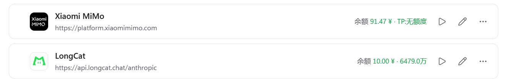
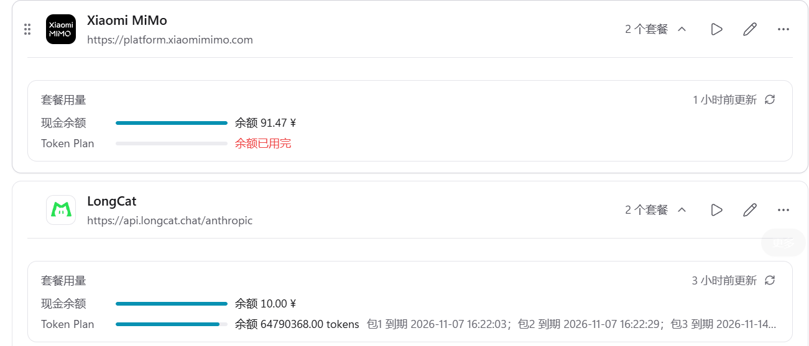

# CC Switch Balance Sync

在 CC Switch 中自动显示多家供应商大模型余额的一体化工具。

> ⚠️ **本项目仅供学习与研究使用**，与小米、美团、CC Switch 官方无关。使用本项目产生的一切后果由使用者自行承担。

> ## ⭐ 这是推荐使用的版本
>
> 另有早期拆分的两个单供应商项目，**均已归档、不再维护**：
>
> | 项目 | 状态 |
> |---|---|
> | [ccswitch-mimo-balance](https://github.com/SkyblueeeLabs/ccswitch-mimo-balance) | 📦 已归档，仅 MiMo |
> | [ccswitch-longcat-balance](https://github.com/SkyblueeeLabs/ccswitch-longcat-balance) | 📦 已归档，仅 LongCat |
> | **本项目** | ✅ **持续维护** |
>
> 归档版代码仍可正常使用，但新增供应商需要改代码、且每家要单独建一个计划任务。
> **本项目只需编辑 `config.json` 即可添加供应商，一个任务管全部。**

## 支持的供应商

| 供应商 | 余额接口 | 认证方式 |
|--------|----------|----------|
| MiMo（小米） | `GET /api/v1/balance` + `GET /api/v1/tokenPlan/usage` | Cookie |
| LongCat（美团） | `POST /api/pay/quota/metering/api-usage/summary` + `POST /api/pay/quota/metering/token-packs/summary` | Cookie |

## 显示效果

### 简略模式



### 完整模式



## 工作原理

```
登录一次所有供应商 → 保存浏览器状态（state.json）
                            ↓
       CC Switch 直接实时请求余额接口 → extractor 提取现金余额
                            ↓
      隐藏的短时计划任务用已保存的 Cookie 更新 Token Plan 快照
                            ↓
        Cookie 过期时 → 任务记日志；运行 2-login 登录并自动同步
```

### 架构说明

```
CC Switch 用量查询
    └──→ HTTPS 余额接口（每次查询取最新现金余额）

Windows 计划任务（每 10 分钟短暂运行后退出）
    ├──→ 校验 Cookie 并刷新 Token Plan 快照
    └──→ 更新 CC Switch 数据库（无需重启应用）
```

> CC Switch 的自定义脚本每次只发一个 HTTP 请求。现金余额由 CC Switch 直接查询；MiMo 和 LongCat 的 Token Plan 来自各自的接口，由短时计划任务更新快照。MiMo 显示剩余 tokens 数量，LongCat 显示套餐额度。项目不再启动常驻本地代理。
> CC Switch 对当前使用中的供应商每 5 分钟自动查询一次；需要立即刷新时，可以点击卡片上的余额信息。Token Plan 快照由计划任务每 10 分钟更新。

### 核心特性

- **多供应商支持**：一个项目管理多家供应商余额
- **实时余额**：CC Switch 每次用量查询直接请求供应商余额接口
- **自动维护**：隐藏计划任务每 10 分钟检查已保存的 Cookie 并更新 Token Plan 快照
- **无需常驻进程**：每轮同步完成后 Node.js 进程退出，不启动本地代理、不重启 CC Switch
- **一键同步**：双击 `3-sync.bat` 立即校验并同步所有供应商
- **用量显示可选**：双击 `5-select-display-mode.bat` 在简略和完整信息间切换 MiMo 与 LongCat

## 前置条件

| 条件 | 说明 |
|------|------|
| ✅ CC Switch 已安装 | 版本 3.0 以上 |
| ✅ 供应商已配置 | 在 CC Switch 里添加供应商，填入有效的 API Key |
| ✅ API 可正常调用 | 能用模型正常对话/推理 |
| ✅ Node.js 已安装 | 版本 22.5 以上（使用内置 `node:sqlite`） |
| ✅ Windows 10/11 | 用于任务计划程序 |

## 安装

### 第一步：安装依赖

双击运行 `1-install.bat`

### 第二步：登录所有供应商

双击运行 `2-login.bat`。它会自动检查所有供应商的已保存登录状态；如果仍有效，会自动保存并同步余额，无需操作。如果某家需要重新登录，在浏览器中完成登录后回到命令行按 **Enter**，脚本会自动保存状态并同步余额。

### 第 2.5 步（首次必须）：设置自定义模板

**打开 CC Switch → 供应商卡片 → 配置用量查询**

对每个供应商：
1. 启用"用量查询"开关
2. 模板选择**"自定义"**
3. 点击**"保存"**

> ⚠️ **这一步只需要做一次**。如果不设置成"自定义"模板，脚本写入的代码会被 cc-switch 覆盖。
> 官方模板、Token Plan 等内置模板都不支持自定义代码。

### 第三步（可选）：手动重新同步

双击运行 `3-sync.bat`

双击运行 `3-sync.bat` 可随时重新校验登录态并更新 CC Switch 用量脚本。通常 `2-login.bat` 保存状态后会自动执行同步。现金余额由 CC Switch 直接实时查询；套餐快照在同步时更新，无需重启 CC Switch。

### 第四步（可选）：设置自动刷新

**右键 `4-setup-task.bat` → 以管理员身份运行**

任务创建后每 10 分钟静默同步一次，输出写入 `auto-sync.log`。Node.js 只在同步期间运行，完成后自动退出。

| 项目 | 值 |
|------|-----|
| 任务名 | `CCSwitchBalanceSync` |
| 频率 | 每 10 分钟 |
| 运行账户 | 当前登录用户（交互式，无需密码） |
| 窗口 | 隐藏运行，无控制台窗口 |
| 日志 | `auto-sync.log` |

创建后可以立即手动触发一次验证：

```bat
schtasks /Run /TN "CCSwitchBalanceSync"
```

> 💡 计划任务通过无控制台启动器运行同步，**不打开控制台或浏览器**，同步结束即退出。
> 只有 Cookie 过期时才需要你手动双击 `2-login.bat`；如果已保存的登录态仍有效，它会自动获取并同步；否则完成登录后会自动同步。无人值守任务只会记录提示并退出。

> 修改任务启动方式后，请重新运行一次 `4-setup-task.bat`（管理员身份）以更新已登记的任务。首次手动同步或重建任务时会清理旧版代理进程。

> ⚠️ **从旧版单独项目升级上来的话**：旧版各自创建过独立任务
> （`MiMoCookieAutoRefresh` / `LongCatCookieAutoRefresh`），它们仍然每 6 小时运行、
> 并会往同一个 cc-switch 数据库写入**旧版脚本**，覆盖本合并版的结果。
> 请先删掉旧任务，只保留 `CCSwitchBalanceSync`：
>
> ```powershell
> schtasks /Delete /TN "MiMoCookieAutoRefresh" /F
> schtasks /Delete /TN "LongCatCookieAutoRefresh" /F
> ```
>
> 检查当前有哪些任务：`schtasks /Query /FO TABLE | findstr /I "ccswitch balance"`

## 升级 / 卸载

| 操作 | 命令 |
|------|------|
| 查看本项目的任务 | `schtasks /Query /TN "CCSwitchBalanceSync" /V /FO LIST` |
| 删除本项目任务 | `schtasks /Delete /TN "CCSwitchBalanceSync" /F` |
| 立即运行一次 | `schtasks /Run /TN "CCSwitchBalanceSync"` |

## 使用

| 操作 | 方式 | 说明 |
|------|------|------|
| 手动同步 | 双击 `3-sync.bat` | 立即校验接口并更新脚本 |
| 切换用量显示 | 双击 `5-select-display-mode.bat` | 选择简略或完整模式，并立即同步 MiMo 与 LongCat |
| 重新登录 | 双击 `2-login.bat` | Cookie 过期时使用 |
| 自动刷新 | 计划任务每 10 分钟 | 隐藏运行，完成后退出 |

## 添加新供应商

编辑 `config.json`，在 `providers` 数组中添加新条目：

```json
{
  "name": "供应商显示名称",
  "matchName": "供应商名称匹配关键词",
  "loginUrl": "登录页面 URL",
  "homeUrl": "首页 URL",
  "apiUrl": "余额查询接口 URL",
  "method": "GET 或 POST",
  "cookieDomain": "Cookie 域名",
  "cookieNames": ["关键 Cookie 名称"],
  "balancePath": "余额字段路径，如 data.balance",
  "currencyPath": "币种字段路径，如 data.currency",
  "successCheck": "code",
  "tokenPacksApiUrl": "LongCat 套餐接口 URL（可选）",
  "tokenPlanApiUrl": "MiMo Token Plan 接口 URL（可选）",
  "tokenPlanMethod": "Token Plan 接口方法，默认 GET",
  "tokenPlanItemNames": ["要统计的额度项名称"]
}
```

> **Token Plan 配置**：LongCat 使用 `tokenPacksApiUrl` 解析 Token Pack 剩余/总量；MiMo 使用 `tokenPlanApiUrl`、`tokenPlanItemNames` 解析额度项的 `limit - used`。MiMo 以 `¥ · X万` 紧凑显示。套餐快照最迟约 10 分钟刷新一次。MiMo 目前使用的是控制台会话 Cookie 可访问的接口，该接口未作为稳定公开 API 发布，供应商变更后可能需要调整字段或请求方式。MiMo 官方将 Token Plan 定位为编程工具套餐；本项目只读取控制台额度信息，不使用 Token Plan 凭证调用模型接口，仍请遵守[官方使用说明](https://mimo.mi.com/docs/zh-CN/tokenplan)。

> **显示模式**：双击 `5-select-display-mode.bat`，选 1 让 MiMo 与 LongCat 都使用简略摘要，选 2 分开展示现金余额和 Token Plan。简略模式下无套餐时显示 `TP:无额度`；完整模式保留 `Token Plan` 全称，无额度时显示 0 tokens。选择会保存在本地 `display-mode.json` 并立即同步；之后的 10 分钟计划任务沿用该选择。切换模式无需重新运行 `4-setup-task.bat`。

> ⚠️ **路径要写全**：`balancePath` 必须包含 `data.` 前缀（如 `data.paygoBalance.primary.amount`）。
> CC Switch 传给 extractor 的是接口原始响应体，`data` 不会被自动解包。
> 写成 `balance` 之类去掉 `data.` 的路径会导致 QuickJS 报「执行 extractor 失败」。

**如何获取这些参数：**
1. 登录供应商控制台，打开余额页面
2. F12 → Network → Fetch/XHR
3. 找到返回余额的请求，记录 URL、Method、Cookie
4. 查看 Response，找到余额字段的路径

## 文件说明

| 文件 | 用途 |
|------|------|
| `config.json` | 供应商配置（接口、字段映射） |
| `display-mode.json` | 当前用量显示模式（选择器自动生成，本地保存） |
| `1-install.bat` | 安装 Playwright 和 Chromium |
| `2-login.bat` | 复用有效登录态或重新登录，并自动同步余额 |
| `3-sync.bat` | 手动同步所有供应商状态和套餐快照 |
| `4-setup-task.bat` | 创建自动刷新任务（需管理员权限） |
| `5-select-display-mode.bat` | 选择 MiMo 与 LongCat 的简略或完整显示模式 |
| `set-display-mode.ps1` | 保存显示模式设置 |
| `setup-task.ps1` | 任务创建脚本 |
| `run-auto-sync-hidden.vbs` | 无控制台启动自动同步 |
| `run-auto-sync.ps1` | 运行计划任务并写日志 |
| `stop-legacy-proxy.ps1` | 升级时清理旧版常驻代理 |
| `playwright-login.mjs` | 登录脚本 |
| `playwright-cookie.mjs` | 余额同步脚本 |
| `playwright-auto.mjs` | 自动维护脚本（计划任务用） |
| `auto-sync.log` | 计划任务运行日志（自动生成） |
| `state.json` | 浏览器登录状态（每台机器不同，不打包） |
| `cc-switch.backup-*.db` | CC Switch 数据库备份（自动生成） |

## 安全提示

- **Cookie 是账号级登录态**：获取 Cookie 后可以操作你的账号，风险高于普通 API Key
- **不要分享 `state.json`**：该文件包含你的完整登录状态
- **谨慎使用云同步**：如果 CC Switch 开启了 WebDAV 自动同步，Cookie 会被上传到云端
- **同步不开放本地端口**：CC Switch 和计划任务直接通过 HTTPS 访问供应商接口
- **Cookie 仍需保护**：用量脚本会把 Cookie 写入 CC Switch 本地数据库；请保护数据库和 `state.json`

### 上传到 GitHub 前

本项目**没有硬编码任何密钥**，`config.json` 里只有接口地址和字段路径，可以安全提交。

`.gitignore` 已排除以下内容：

| 被排除 | 原因 |
|--------|------|
| `state.json` | **含真实登录 Cookie，泄露等于账号被接管** |
| `cc-switch.backup-*.db` | 数据库备份，含写入的 Cookie |
| `*.db` | 同上的兜底规则 |
| `*.log` | 日志可能含 debug 信息 |

上传前建议自查一遍：

```bash
git status                      # 确认 state.json 不在列表里
git ls-files | findstr state    # 应无输出
```

> ⚠️ 如果 `state.json` **曾经**被提交过，仅仅加 `.gitignore` 是没用的 ——
> 它仍留在历史里。需要 `git rm --cached state.json` 后用
> [git-filter-repo](https://github.com/newren/git-filter-repo) 清理历史，
> 并**立即到供应商控制台重新登录**使旧 Cookie 失效。

## 常见问题

**Q: 同步失败怎么办？**
A: 运行 `2-login.bat`。它会检查现有登录态，需要时让你重新登录，并在保存后自动同步；也可以单独运行 `3-sync.bat` 重试。

**Q: 余额不显示？**
A: 确认供应商的用量查询已设置成"自定义"模板并保存。

**Q: 自动刷新不工作？**
A: 检查任务是否存在：`schtasks /Query /TN "CCSwitchBalanceSync"`，并查看 `auto-sync.log` 了解每轮结果。手动触发测试：`schtasks /Run /TN "CCSwitchBalanceSync"`。

**Q: 自动刷新时会不会弹浏览器窗口？**
A: 不会。计划任务使用隐藏 PowerShell 运行器，常规同步不启动浏览器；任务进程完成后自动退出。Cookie 过期时只写日志，不会弹窗卡住。

**Q: 余额显示的数字过一会儿又变回去了 / 修复的问题反复出现？**
A: 大概率是有**旧的独立任务还在运行**，往同一个数据库写旧脚本。检查并删除旧任务：

```powershell
schtasks /Query /FO TABLE | findstr /I "ccswitch balance mimo longcat"
schtasks /Delete /TN "MiMoCookieAutoRefresh" /F
schtasks /Delete /TN "LongCatCookieAutoRefresh" /F
```

只保留 `CCSwitchBalanceSync` 一个任务。

**Q: 支持哪些供应商？**
A: 理论上支持所有有余额查询接口的供应商。只需在 `config.json` 中添加配置即可。

**Q: 为什么需要管理员权限创建任务？**
A: Windows 任务计划程序需要管理员权限才能创建任务。创建一次后，后续运行不需要。

**Q: 提示「执行 extractor 失败: Exception generated by QuickJS」？**
A: 说明写入 CC Switch 的脚本取值路径错了。关键点：**extractor 收到的 `response` 是接口原始响应体，`data` 不会被解包**，因此路径要写完整的 `data.balance`，不能简写成 `balance`。这类错误在 QuickJS 里表现为变量未定义的异常。重新运行一次 `3-sync.bat` 会覆盖修正。

**Q: 余额只显示一个数字，没有 Token Plan？**
A: 检查 `config.json` 里该供应商是否配置了对应接口：LongCat 使用 `tokenPacksApiUrl`，MiMo 使用 `tokenPlanApiUrl`。还要确认计划任务或 `3-sync.bat` 最近成功同步过。

**Q: 还需要本地代理吗？**
A: 不需要。CC Switch 直接请求现金余额接口；MiMo 和 LongCat Token Plan 由计划任务更新快照。

**Q: 想在简略和完整显示之间切换？**
A: 双击 `5-select-display-mode.bat` 并选择模式。简略模式把余额和 TP 放在同一行；完整模式分开展示余额与 Token Plan 剩余量、总量和已用量，LongCat 还会显示接口提供的到期信息。脚本会保存设置并立即同步。没有额度时保留 `Token Plan` 项，剩余显示为 0 tokens。

## 免责声明

1. 本项目仅供学习与研究用途，不得用于任何商业或非法目的
2. 使用本项目所产生的一切后果由使用者自行承担，包括但不限于账号封禁、数据泄露等
3. 本项目与小米、美团、CC Switch 官方无任何关联
4. 请遵守各供应商的服务条款
5. 本项目按"原样"提供，不提供任何明示或暗示的担保

## 许可

本项目代码基于 MIT 许可证开源。使用本项目即表示你同意上述免责声明。
